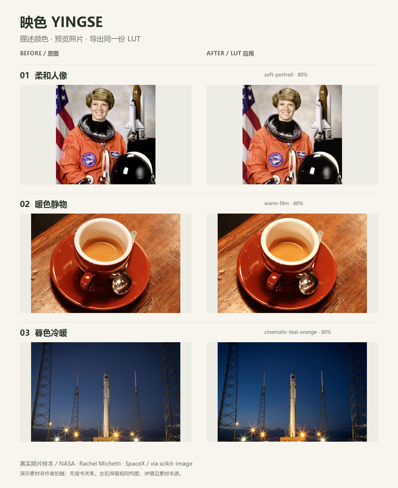

# Codex Skills

Reusable Codex skills for visual creation, imaging, color workflows, and creative tools.

面向视觉创作、影像处理和创意工作流的 Codex Skills 集合。每个目录包含独立的 `SKILL.md` 和所需资源。

## Featured · 映色 Yingse

**一句话描述想要的颜色，用自己的照片看效果，再导出可复用 LUT。**

Photo color grading with a preview of the exact exported `.cube`, reusable recipes, and local validation.

[查看三组真实照片对比与使用说明](generate-lut/README.md) · [下载可运行演示包](generate-lut/examples/yingse-starter-pack.zip)



Demo photographs are credited open samples, not the author's photography or endorsements. [Credits](generate-lut/examples/SOURCES.md).

```bash
npx skills add kaiyihe699-max/codex-skills --skill generate-lut
```

After installing, ask your agent: **“使用 $generate-lut，用自带人像样本做柔和暖调，展示对比并导出 LUT 和配方。”**

Photo previews need Python 3.10+ and Pillow. [First-run guide / 首次试用](generate-lut/README.md#第一次试用).

## Start here

- [product-color-match](product-color-match/) — align product colors to an approved reference, including RAW input and 16-bit TIFF output.
- [generate-lut / 映色](generate-lut/README.md) — describe a look, preview it on a photo, and export the same LUT with a replayable recipe. Advanced tools include technical transforms and Panasonic S9 profile checks. See the [camera compatibility guide](generate-lut/references/camera-compatibility.md) and [S9 profile](generate-lut/references/camera-profiles/panasonic-dc-s9.json).
- [film-scan-lab](film-scan-lab/) — analyze, invert, restore, and archive film scans.
- [raw-darkroom](raw-darkroom/) — inspect and develop camera RAW files.
- [dream-sequence](dream-sequence/) — build connected visual stories from text or reference images.
- [optical-polish](optical-polish/) — measure and correct optical alignment in graphics and UI.

## Included skills

| Skill | Purpose |
| --- | --- |
| [dream-sequence](dream-sequence/) | Turn stories, keywords, or references into connected dreamlike visual sequences. |
| [film-scan-lab](film-scan-lab/) | Analyze, invert, restore, and archive film scans or camera reproductions. |
| [generate-lut](generate-lut/) | Generate, adjust, preview, batch-apply, and package creative or technical LUTs. |
| [hatch-pet](hatch-pet/) | Create and validate Codex-compatible v2 animated pets. |
| [humanizer-zh](humanizer-zh/) | Remove common AI-writing patterns from Chinese text. |
| [meeting-notes](meeting-notes/) | Convert raw meeting material into structured notes and action items. |
| [optical-polish](optical-polish/) | Measure and correct optical alignment in UI components and graphics. |
| [product-color-match](product-color-match/) | Match product photo colors to an approved reference with localized masks and RAW support. |
| [photo-roast-critique](photo-roast-critique/) | Produce sharp Chinese photography critiques with practical fixes. |
| [raw-darkroom](raw-darkroom/) | Decode, analyze, and develop camera RAW files. |
| [simulation-sandbox](simulation-sandbox/) | Build runnable toy simulations from rule systems or domain ideas. |
| [synesthesia-mapper](synesthesia-mapper/) | Map images deterministically into music and visual scores. |

## Related project

[Classical Page Lab](https://github.com/kaiyihe699-max/classical-page-lab) turns modern Chinese text into a configurable classical-book-style page and exports PNG, SVG, and interactive HTML.

## Installation

Copy the desired skill folder into your Codex skills directory. Each skill contains its own `SKILL.md` and any scripts, references, tests, or assets it needs.

The built-in `.system` skills and generated Python cache files are intentionally excluded from this repository.

## License

Licensing varies by skill. [Yingse / generate-lut](generate-lut/LICENSE) code and documentation use the MIT License; its sample photographs retain their [documented terms](generate-lut/examples/SOURCES.md). Other skills keep their own existing terms. Review each folder before redistributing.


